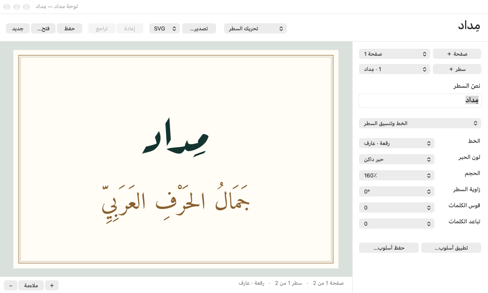
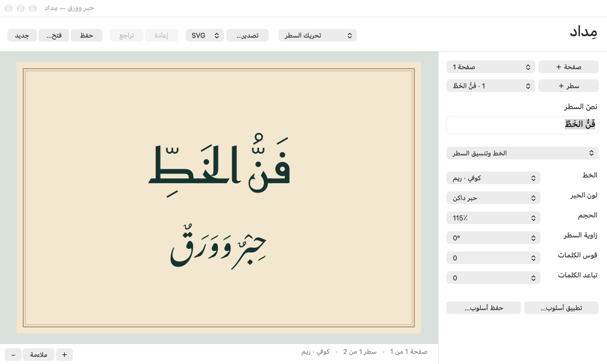
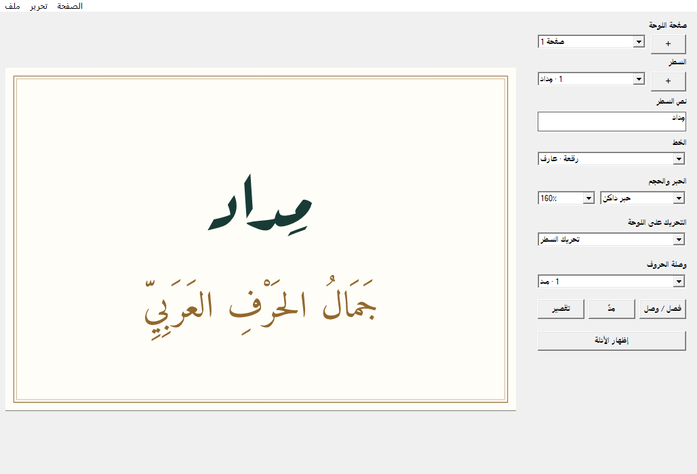

# مِداد

محرّر مكتبي للخط العربي على macOS وWindows، مكتوب بلغة Rust. اكتب نص اللوحة، ثم اضبط مواضع الكلمات والحروف والحركات بالسحب. يحفظ مداد الصفحات في مشروع محلي بصيغة `.midad`، ويصدّر العمل إلى SVG وPNG وPDF.



## تنزيل مداد 0.5.0

| النظام | التنزيل | التثبيت |
| --- | --- | --- |
| macOS على Apple Silicon وIntel | [صورة القرص DMG](https://github.com/AHMED-ABDULLA-BH/Midad.code/releases/download/v0.5.0/Midad-0.5.0-macOS-universal.dmg) | افتح صورة القرص واسحب **مداد** إلى **Applications**. |
| Windows 10 و11، معمارية x64 | [مثبّت Windows](https://github.com/AHMED-ABDULLA-BH/Midad.code/releases/download/v0.5.0/Midad-0.5.0-Windows-x64.exe) | شغّل المثبّت ثم افتح **Midad** من قائمة ابدأ. يتم التثبيت لحساب المستخدم الحالي. |

تتوفر بصمات SHA-256 في [صفحة الإصدار](https://github.com/AHMED-ABDULLA-BH/Midad.code/releases/tag/v0.5.0). وقّع فريق **Ahmed Al Mulla** تطبيق مداد للماك بشهادة Developer ID Application. وثّقت Apple التطبيق، وتذكرة التوثيق مرفقة به داخل صورة القرص. مثبّت Windows غير موقّع بشهادة ناشر تجارية.

## جرّب لوحة

1. افتح [مشروع «لوحة مداد»](examples/لوحة%20مداد.midad) من قائمة **ملف**.
2. اختر الصفحة والسطر، واكتب في حقل **نص السطر**. تضم اللوحة صفحتين بأربعة خطوط.
3. اختر وضع التحريك ثم اسحب السطر أو الكلمة أو الحرف أو الحركة على الورقة. استخدم قائمة الوصلات لتطويل وصلة بعينها أو فصلها.
4. احفظ المشروع لمواصلة التحرير. يصدّر SVG وPNG الصفحة الحالية، بينما يجمع PDF صفحات المشروع.



## واجهة ويندوز



## الأدوات

- تتضمن النسختان أربعة خطوط مرفقة، وتحرير النص العربي وتشكيله، وإدارة الصفحات والأسطر، والحبر والحجم، والتراجع والإعادة.
- يمكن استيراد ملفات `.klx` المدعومة، بما فيها مواضع الكلمات والزخارف وأدلة المحاذاة المستقيمة والدائرية والبيضاوية. يظهر الرمز **�** عند تعذّر قراءة محرف. يعتمد شكل الحروف على الخطوط المتاحة داخل مداد.
- تتضمن واجهة macOS أيضًا بدائل الحروف، وحبر الكلمة، وحفظ أسلوب الخطاط، والطباعة، ومراجعة الرموز غير المقروءة. ويدعم المحرر خطوطًا إضافية إذا كانت متوفرة في النظام.

## البناء من المصدر

يتطلب البناء سلسلة Rust مستقرة تدعم إصدار اللغة 2024. من جذر المشروع شغّل:

```sh
cargo test --locked
cargo run --release --locked
```

على macOS ثبّت أدوات Xcode لسطر الأوامر. لإنشاء صورة قرص للمعماريتين:

```sh
rustup target add aarch64-apple-darwin x86_64-apple-darwin
./packaging/macos-release.sh
```

على Windows استخدم Rust بهدف `x86_64-pc-windows-msvc`، وأدوات Visual Studio للبناء بلغة C++، وNSIS 3 لإنشاء المثبّت:

```powershell
cargo build --locked --release
makensis /INPUTCHARSET UTF8 packaging/windows.nsi
```

توجد تراخيص الخطوط بجوار ملفاتها في [assets](assets)، وإشعارات المكتبات في [THIRD-PARTY.txt](packaging/THIRD-PARTY.txt).
